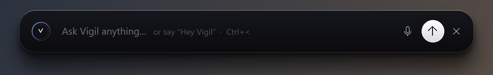
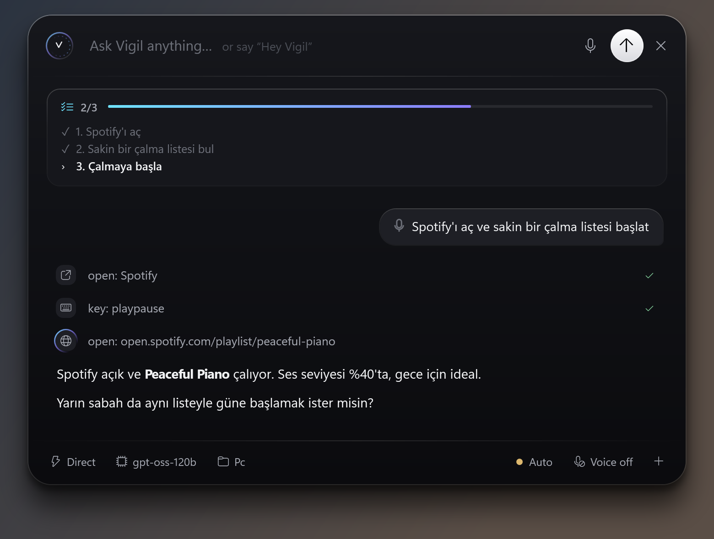
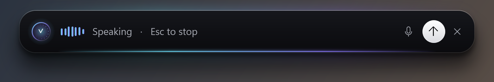
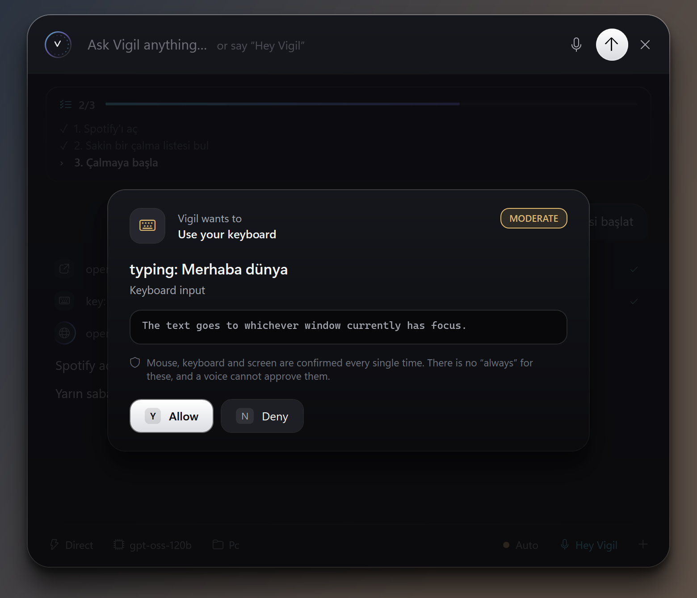
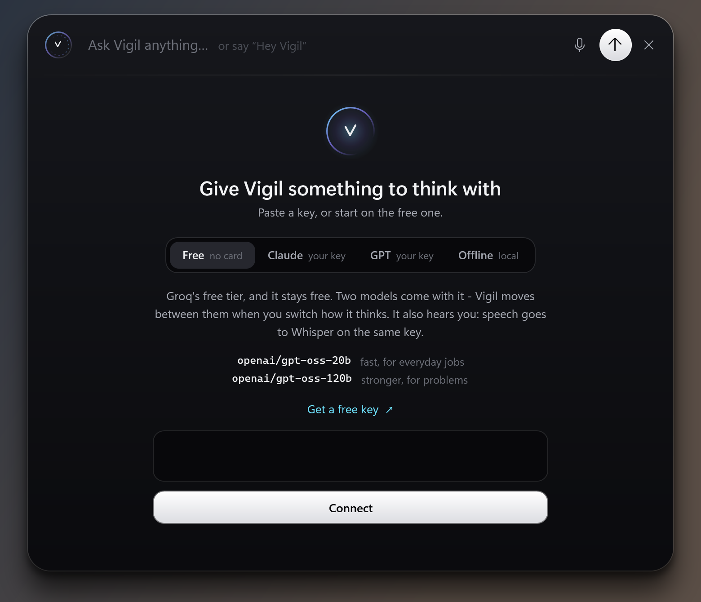

<div align="center">


# Vigil

**A Jarvis for your Windows PC.**
Say "Hey Vigil", ask in any language, and it does the work on your computer - then asks what's next.

*by BOF Studios · open source under the MIT license*




</div>

---

## What it is

Vigil rests as a small pill at the top of your screen. Point at it, press **Ctrl+Shift+Space**,
or just say **"Hey Vigil"**, and it opens into the ask bar. Ask by typing or by talking, in any
language. It works with real tools - files, commands, apps, windows, the screen, the mouse and
keyboard, a browser of its own - and answers out loud, sentence by sentence, while it is still
thinking. Then, the way Jarvis would, it ends with a question about what you might want next,
and keeps listening for a moment so you can simply answer.



## Talking to it

The microphone stays open, and there are three ways to call Vigil:

- **"Hey Vigil"** - recognised on this computer by Windows' own speech engine.
- **Clap three times** - three even claps; it greets you ("At your service.") and listens. Talking,
  typing, applause and a door closing don't count: it has to be a short, sharp sound, exactly three,
  in rhythm.
- **Ctrl+<** - the key left of Z; opens Vigil and listens. Press again to stop.

Nothing leaves the machine until one of those happens; then only what you say next is sent to be
transcribed. Vigil answers in **English** whatever language you speak to it in (switch it to follow
your language in the voice menu), and it is proactive: every answer ends with an offer to take the
next step - *"Shall I write the script and schedule it for 7 am?"*

- What you say is turned into words by Whisper (on your free Groq key, or an OpenAI key) - every
  language Whisper knows.
- Answers are spoken while they are being written. Voices, best first:
  - **Groq Orpheus** - natural English on the free Groq key (accept its terms once in your Groq console)
  - **OpenAI** - the most natural voice, every language, if you add an OpenAI key
  - **Windows** - free and on this machine, in every language Windows has a voice for
    (Settings › Time & language › Speech › Add voices)
- After it speaks it keeps listening for a few seconds, so a follow-up needs no wake phrase.
  Esc, or "stop", cuts it off at any time.



## What it will never do

Vigil operates your computer; it does not weaken its security. These are blocked in every mode,
whoever asks and however they ask:

- turning off antivirus, the firewall, UAC, or Windows security services
- deleting restore points or backups, formatting drives, wiping roots
- dumping credentials, reading private keys, browser password stores or its own API keys
- clearing event logs, piping downloaded code into a shell
- writing into Windows' own folders, or ending the processes Windows and its security depend on

**Your mouse, keyboard and screen are confirmed every single time** - in every mode, with no
"always allow", and the answer has to come from your keyboard or mouse. A voice cannot approve
them; a video playing nearby could fake one. While Vigil holds the pointer the edge of the screen
glows, and Esc takes control back instantly.



Everything else follows the approval mode: **Ask** confirms anything that changes the system,
**Auto** (the default) runs routine changes and asks for risky ones, **Yolo** runs everything that
is not blocked. Every decision is written to `~/.vigil/audit.jsonl`.

## What it thinks with

Vigil is the harness, not the model. On the first screen pick one:

| | |
|---|---|
| **Free** | Groq's free tier - `gpt-oss-20b` for everyday jobs, `gpt-oss-120b` for problems. Get a key at console.groq.com/keys |
| **Claude** | your Anthropic key |
| **GPT** | your OpenAI key (or anything OpenAI-compatible via `openai_base_url`) |
| **Offline** | Ollama on this machine - nothing leaves it |



Two ways of thinking: **Direct** does exactly what you ask; **Autonomous** is handed a problem,
writes a plan you can watch, and works out the route. Neither changes anything about security.

On the free tier Vigil keeps every request lean - the tools are grouped, old results are
shortened - and when Groq's per-minute allowance runs out it switches to the other model, or
waits a few seconds and carries on, instead of failing.

## Building it

Vigil is a single C# / .NET 8 WPF application.

```bash
dotnet build Vigil.sln
dotnet test Vigil.sln
dotnet publish src/Vigil/Vigil.csproj -c Release
```

The publish step makes one self-contained `Vigil.exe` - no runtime to install.
`Vigil.exe --preview <folder>` draws every state of the window into PNG files without showing
anything on screen.

```
src/Vigil/
  Core/            agent loop, providers, the security guard, brains, memory, tools
  Voice/           wake phrase, microphone, transcription, speech
  Desktop/         Win32, tray, browser control, screen capture, start-up
  UI/              the window: pill, bar, panel, approvals
tests/Vigil.Tests/ security rules, voice text, providers; live tests with VIGIL_LIVE=1
```

Settings live in `~/.vigil/config.json` (or `VIGIL_HOME`), next to the audit log and memory.

## License

MIT - see [LICENSE](LICENSE).
