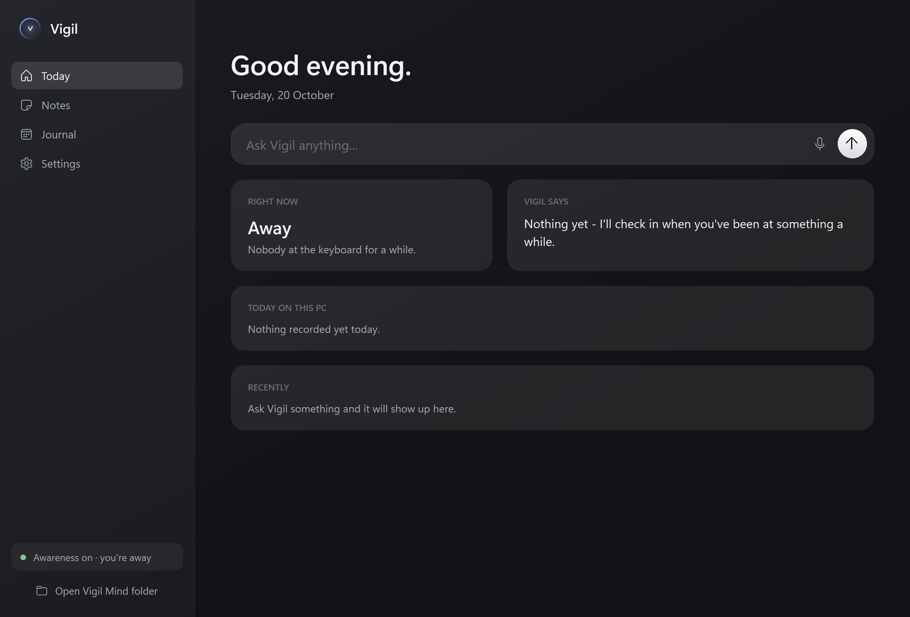

<div align="center">


# Vigil

**A Jarvis for your Windows PC.**
Hold a key, ask in any language, and it does the work on your computer - then asks what's next.

*by BOF Studios · open source under the MIT license*


</div>

---

## What it is

Vigil rests as a small pill at the top of your screen. Press **Ctrl+Shift+Space** and it opens into
the ask bar. Ask by typing, or **hold Ctrl+<** and talk - in any language. It works with real
tools - files, commands, apps, windows, the screen, the mouse and keyboard, a browser of its
own - and answers out loud, sentence by sentence, while it is still thinking. Then, the way
Jarvis would, it ends with a question about what you might want next.


## Talking to it

**Hold Ctrl+<** (the key left of Z), say it, let go. What you say appears in the bar as you say it,
and is sent when you release. A quick tap listens until you stop talking. Pressing it while Vigil
speaks cuts Vigil off - that is how you interrupt - and music or a video playing in another app
drops to a murmur while you talk, then comes back.

The microphone is closed the rest of the time. Nothing listens in the background unless you switch
it on: **"Hey Vigil"** (recognised on this computer by Windows' own speech engine) and **three claps**
are there for anyone who wants them, off by default.

- What you say is turned into words by Whisper (on your free Groq key, or an OpenAI key) - every
  language Whisper knows - and it works out what you meant: *"Madonna's prayer song"* plays
  Madonna - Like a Prayer.
- **Talk mode** speaks every answer, even a typed one; you still talk by holding Ctrl+<.
- Vigil answers in **English** whatever language you speak to it in (switch it to follow your
  language in the voice menu).
- Answers are spoken while they are being written. Voices, best first:
  - **Voicebox** - free and local ([voicebox.sh](https://voicebox.sh), MIT): natural voices that run on
    your PC, no key, nothing leaves it. Vigil uses it whenever it is running.
  - **ElevenLabs** - with your own key, the most natural voice, every language
  - **Piper** - a neural voice on this PC, if you add a model
  - **Groq Orpheus** - natural English on the free Groq key (accept its terms once in your Groq console)
  - **OpenAI** - every language, with an OpenAI key
  - **Windows** - free and on this machine, in every language Windows has a voice for
- Esc, or "stop", cuts it off at any time.


## A second brain

Click the icon by the clock and Vigil opens as an app: **Today**, **Notes**, **Journal** and
**Settings** in one window.



- **Vigil Mind** - a folder in your Documents where everything Vigil keeps lives as plain files
  you can open yourself: `Notes` (markdown, written when you ask it to remember something),
  `Journal` (one file a day: what you asked, what it did, what it refused) and `Activity`.
- **Awareness** - Vigil notes which app is in front and for how long. App names and minutes only:
  no window titles, no screen, no keystrokes, and nothing leaves the PC except as context for the
  question you ask. A dot in the app shows when it is on; one switch turns it off, and "Forget
  today" deletes the day.
- **Check-ins** - after a long stretch in one app, or when you come back after a break, it says
  something short, the way a friend at the next desk would - *"Two hours in VS Code. Want me to
  write down where you got to?"* Off with one switch, and it never interrupts while it is working
  or asking you something.
- **Work mode** - tell it what you are working on and it keeps an eye on how the work goes: how long
  in each app, how often you jump between them, how long since a break. Every ten minutes (or 20,
  or 30) it steps in with one concrete thing - *"19 app switches in 10 minutes - close Discord and
  WhatsApp and give the next 25 minutes to VS Code."* It works from app names and minutes only,
  and Do not disturb silences it.

## What it will never do

Vigil operates your computer; it does not weaken its security. These are blocked in every mode,
whoever asks and however they ask:

- turning off antivirus, the firewall, UAC, or Windows security services
- deleting restore points or backups, formatting drives, wiping roots
- dumping credentials, reading private keys, browser password stores or its own API keys
- clearing event logs, piping downloaded code into a shell
- writing into Windows' own folders, or ending the processes Windows and its security depend on

**Your mouse, keyboard and screen are handed over by you, once per task** - in every mode, with no
"always allow", and the answer has to come from your keyboard or mouse. A voice cannot approve
them; a video playing nearby could fake one. Control goes back when the task ends, the next task
asks again, and while Vigil holds the pointer the edge of the screen glows and Esc takes control
back instantly, from any app.


Everything else follows the approval mode: **Ask** confirms anything that changes the system,
**Auto** (the default) runs routine changes and asks for risky ones, **Yolo** runs everything that
is not blocked. Every decision is written to `~/.vigil/audit.jsonl`.

## What it thinks with

Vigil is the harness, not the model. On the first screen pick one:

| | |
|---|---|
| **Free** | Groq's free tier - `gpt-oss-20b` for everyday jobs, `gpt-oss-120b` for problems. Get a key at console.groq.com/keys |
| **Gemini** | Google's free key - `gemini-2.5-flash`, or `gemini-2.5-pro`. Get one at aistudio.google.com/apikey |
| **Claude** | your Anthropic key |
| **GPT** | your OpenAI key (or anything OpenAI-compatible via `openai_base_url`) |
| **Offline** | Ollama on this machine - nothing leaves it |


Two ways of thinking: **Direct** does exactly what you ask; **Autonomous** is handed a problem,
writes a plan you can watch, and works out the route. Neither changes anything about security.

On the free tier Vigil keeps every request lean - the tools are grouped, finished turns are kept as
question and answer, every request stays under Groq's per-minute allowance - and when it runs out
Vigil switches to another model, or waits a few seconds and carries on, instead of failing.

## Building it

Vigil is a single C# / .NET 8 WPF application.

```bash
dotnet build Vigil.sln
dotnet test Vigil.sln
dotnet publish src/Vigil/Vigil.csproj -c Release
```

The publish step makes one self-contained `Vigil.exe` - no runtime to install.
`Vigil.exe --preview <folder>` draws every state of the window into PNG files without showing
anything on screen.

```
src/Vigil/
  Core/            agent loop, providers, the security guard, brains, memory, tools
  Voice/           push to talk, microphone, transcription, speech, sound ducking
  Desktop/         Win32, tray, browser control, screen capture, start-up
  UI/              the bar (pill, panel, approvals, check-ins) and the app window
tests/Vigil.Tests/ security rules, voice text, providers, Vigil Mind; live tests with VIGIL_LIVE=1
```

Settings live in `~/.vigil/config.json` (or `VIGIL_HOME`), next to the audit log and memory.

## License

MIT - see [LICENSE](LICENSE).
